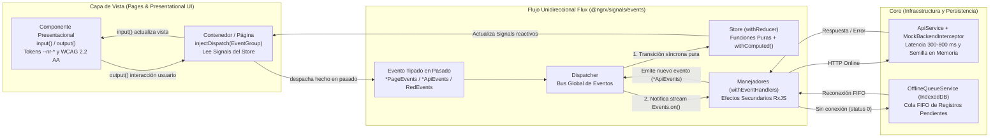

# NutriRuta — Prototipo Funcional con Arquitectura Flux y NgRx SignalStore

**NutriRuta** es una aplicación web académica (SPA) que conecta al nutricionista con su paciente entre consultas, construida estrictamente bajo el patrón arquitectónico **Flux** utilizando **Angular 22** (componentes standalone, Signals, control de flujo `@if`/`@for`, detección de cambios **zoneless** y carga diferida) y **@ngrx/signals** con su plugin de eventos `@ngrx/signals/events`.

Ofrece dos experiencias complementarias conectadas a la misma base de datos simulada en memoria:
1. **App del paciente (`Jorge R.`, 45 años, prediabetes)**: diseño *mobile-first* (ancho base `375 px`), orientada a que el paciente registre su día en **menos de 60 segundos** con un solo toque, operación sin conexión respaldada en IndexedDB nativo y gráficas accesibles de progreso.
2. **Panel del nutricionista (`Dra. Camila Restrepo`, ~60 pacientes)**: diseño de escritorio (`≥ 1280 px`), operable 100 % con teclado, con directorio priorizado por baja adherencia («Requiere atención»), ficha clínica con indicadores calculados al instante (`computed()`), formulario reactivo tipado de valoración en 5 secciones y asignación de planes.

---

## 1. Requisitos e Instalación

El proyecto no requiere pasos manuales ni servidores externos.

- **Node.js**: `v22 LTS` o `v24 LTS` (probado con `v24.15.0`)
- **Gestor de paquetes**: `npm` (`v11+`)

```bash
# 1. Instalar dependencias
npm install

# 2. Iniciar servidor de desarrollo (http://localhost:4200)
npm start

# 3. Compilar para producción (TypeScript en modo strict, 0 errores y 0 warnings)
npm run build

# 4. Ejecutar suite de pruebas unitarias (Vitest)
npm test

# 5. Ejecutar análisis estático y validación de fronteras entre features (ESLint)
npm run lint
```

---

## 2. Versiones Exactas y Notas de API (`@ngrx/signals/events`)

| Paquete | Versión instalada | Uso en NutriRuta |
|---|---|---|
| `@angular/core` / `@angular/cli` | `22.3.0` | Componentes standalone, Signals (`signal`, `computed`, `input()`, `output()`), `provideZonelessChangeDetection()`, Reactive Forms tipados |
| `@ngrx/signals` | `22.0.1` | `signalStore`, `withState`, `withComputed`, `type` y plugin `@ngrx/signals/events` (`eventGroup`, `withReducer`, `on`, `withEventHandlers`, `Events`, `Dispatcher`, `injectDispatch`) |
| `@ngrx/operators` | `22.0.1` | `mapResponse` en manejadores de eventos |
| `@angular-architects/ngrx-toolkit` | `21.0.1` | `withDevtools` / `withDevToolsStub` activado **únicamente en desarrollo** (`isDevMode()`) |
| `vitest` | `5.0.0` | Runner de pruebas unitarias configurado por Angular CLI |
| `eslint` / `angular-eslint` | `10.15.0` / `22.8.0` | Regla `no-restricted-imports` que prohíbe importaciones cruzadas entre carpetas de `features/` (salvo `evolucion`, que es compartido) |

> **Nota sobre API de NgRx Signals 22:** Se verificaron las definiciones en `node_modules/@ngrx/signals/types/ngrx-signals-events.d.ts` y la función oficial para manejadores de efectos secundarios se llama exactamente **`withEventHandlers`** (reemplazando al antiguo `withEffects` de versiones previas a NgRx 21). Se utilizaron todos los nombres exactos solicitados sin necesidad de alias.

---

## 3. Arquitectura Flux Unidireccional

El estado de dominio **solo** cambia cuando un store procesa un evento mediante funciones puras en `withReducer`. Ningún componente llama a `ApiService` ni utiliza `patchState`.

### Diagrama del flujo Flux en Mermaid



### Tabla de responsabilidades por capa

| Capa | Responsabilidad en NutriRuta | Prohibido (validado por revisión y ESLint) |
|---|---|---|
| **Presentacional (`components/` y `shared/ui/`)** | Recibir datos con `input()`, emitir interacciones con `output()`, aplicar tokens semánticos `--nr-*` y atributos de accesibilidad WCAG 2.2 AA | Inyectar stores, `ApiService` o servicios de negocio |
| **Contenedor / Página (`pages/`)** | Leer señales de los stores, despachar eventos con `injectDispatch`, gestionar estado efímero de UI en `signal()` local y componer componentes presentacionales | Llamar a `ApiService`, calcular indicadores clínicos o usar `patchState` |
| **Eventos (`*.events.ts`)** | Describir hechos ocurridos con payload tipado, nombrados **en pasado** y agrupados por origen (`*PageEvents`, `*ApiEvents`, `SessionEvents`, `RedEvents`) | Nombres imperativos tipo `setX` o `updateAll` |
| **Store de dominio (`*.store.ts`)** | Ser dueño del estado de su dominio con `withState`, `withReducer` (funciones puras), `withComputed` y reaccionar a `sesionCerrada` volviendo al estado inicial | Realizar llamadas HTTP, acceder al DOM, modificar otro store o exponer métodos públicos que muten el estado |
| **Manejadores (`*.handlers.ts`)** | Ejecutar efectos secundarios en `withEventHandlers`: llamadas HTTP a `ApiService`, encolamiento offline en IndexedDB y reintentos FIFO al reconectar, emitiendo eventos `*ApiEvents` | Modificar el estado del store directamente |
| **Core (`core/`)** | `ApiService`, `mockBackendInterceptor` (estado compartido en memoria), `errorInterceptor`, `SessionStore`, `roleGuard`, `OfflineQueueService` (IndexedDB nativo) y `ConnectivityService` | Contener reglas de negocio de componentes |

---

## 4. Catálogo Final de Eventos

Todos los eventos están nombrados **en pasado** y agrupados con `eventGroup`:

| Origen (`source`) | Evento | Quién lo emite | Stores que reaccionan (`withReducer`) | Manejador (`withEventHandlers`) |
|---|---|---|---|---|
| `Sesión` | `sesionIniciada` | `LoginPageComponent` | `SessionStore` (guarda usuario y consentimiento en memoria) | Navega a `/paciente/hoy` o `/profesional` según el rol |
| `Sesión` | `sesionCerrada` | Barra superior / Perfil | **Todos los stores** (`SessionStore`, `RegistrosStore`, `EvolucionStore`, `PacientesStore`, `ValoracionStore`, `PlanesStore`) vuelven a su estado inicial | Limpia la cola de IndexedDB y navega a `/login` |
| `Registro Page` | `hoyAbierta` | `PacienteShellPageComponent` | `RegistrosStore` (`cargando: true`) | `GET /api/paciente/hoy` → emite `hoyCargado` o `hoyFallido` |
| `Registro Page` | `comidaRegistrada` | `RegistrarComidaPageComponent` | `RegistrosStore`: agrega registro con estado `pendiente` (**optimista** y mensaje `Registro guardado`) | Despacha `adherenciaRecalculadaPorRegistro`; hace `POST /api/registros` o guarda en `OfflineQueueService` si no hay red |
| `Registro Page` | `avisoLimpiado` | Vista paciente | `RegistrosStore`: limpia banners de aviso | — |
| `Registro API` | `hoyCargado` / `hoyFallido` | Manejador de registro | `RegistrosStore`: hidrata plan y registros del día conservando items en cola local | — |
| `Registro API` | `registroGuardado` | Manejador de registro | `RegistrosStore`: marca el registro como `sincronizado` | — |
| `Registro API` | `registroEncolado` | Manejador de registro | `RegistrosStore`: marca el registro como `en-cola` y muestra `Guardado sin conexión; se enviará al reconectar` | — |
| `Registro API` | `registroFallido` | Manejador de registro | `RegistrosStore`: **revierte** el registro optimista y muestra mensaje de error empático sin culpa | — |
| `Red` | `conexionPerdida` | `ConnectivityService` | — | — |
| `Red` | `conexionRecuperada` | `ConnectivityService` | `RegistrosStore`: pasa `estadoCola` a `reintentando` | Lee `OfflineQueueService` en orden **FIFO**, hace `POST /api/registros`, elimina de IndexedDB y emite `registroGuardado` por cada ítem |
| `Red` | `simulacionOfflineCambiada` / `forzarErrorApiCambiado` | `ConnectivityService` | Registrados en bus de eventos / DevTools | — |
| `Evolución Page` | `evolucionSolicitada` | `PacienteShell` / `PacientesHandlers` | `EvolucionStore` (`cargando: true`) | `GET /api/pacientes/:id/evolucion` → emite `evolucionCargada` |
| `Evolución API` | `evolucionCargada` / `evolucionFallida` | Manejador de evolución | `EvolucionStore`: actualiza serie de 8 semanas de peso y adherencia | — |
| `Evolución API` | `adherenciaRecalculadaPorRegistro` | Manejador de registro | `EvolucionStore`: recalcula adherencia semanal inmediatamente | — |
| `Evolución API` | `medicionAgregadaPorValoracion` | Manejador de valoración | `EvolucionStore` (agrega medición) y `PacientesStore` (actualiza peso, talla y próximo control en ficha) | Refresca listado de pacientes |
| `Evolución API` | `planPacienteActualizado` | Manejador de planes | `PacientesStore`: actualiza plan activo en la ficha del paciente | Refresca listado de pacientes |
| `Pacientes Page` | `pacientesAbierta` | `PanelProfesionalPageComponent` | `PacientesStore` (`cargandoLista: true`) | `GET /api/pacientes` → emite `pacientesCargados` |
| `Pacientes Page` | `fichaAbierta` | `PanelProfesionalPageComponent` | `PacientesStore` (`cargandoFicha: true`, selecciona paciente) | Despacha `evolucionSolicitada` y ejecuta `GET /api/pacientes/:id` + `GET /api/pacientes/:id/registros` |
| `Pacientes Page` | `busquedaCambiada` | `PanelProfesionalPageComponent` | `PacientesStore`: actualiza `terminoBusqueda` para el `computed` de filtrado y prioridad | — |
| `Pacientes API` | `pacientesCargados` / `fichaCargada` | Manejador de pacientes | `PacientesStore`: almacena lista de pacientes, ficha activa e historial de registros diarios | — |
| `Valoración Page` | `valoracionEnviada` | `ValoracionPageComponent` | `ValoracionStore`: `guardando: true` (**pesimista**, no muta datos clínicos hasta confirmar) | `POST /api/valoraciones` → emite `valoracionConfirmada` o `valoracionRechazada` |
| `Valoración API` | `valoracionConfirmada` / `valoracionRechazada` | Manejador de valoración | `ValoracionStore`: finaliza guardado y expone confirmación o error | — |
| `Planes Page` | `plantillasSolicitadas` / `planAsignado` | `AsignarPlanPageComponent` | `PlanesStore`: `guardando: true` (**pesimista**) | `PUT /api/pacientes/:id/plan` → emite `planConfirmado` o `planRechazado` |
| `Planes API` | `planConfirmado` / `planRechazado` | Manejador de planes | `PlanesStore`: finaliza guardado y muestra confirmación | — |

---

## 5. Decisiones Arquitectónicas Clave

### 5.1. Estrategia Optimista vs. Pesimista
- **Registro diario del paciente (`comidaRegistrada`) → Optimista**: El objetivo de negocio principal es que Jorge R. registre su comida en menos de 60 segundos, incluso en zonas con conectividad inestable desde su teléfono Android. Al tocar «Sí, completo», «Parcialmente» o «No lo seguí», el reducer agrega de inmediato el registro en estado `pendiente` y anuncia `"Registro guardado"` mediante una región `aria-live="polite"`. Si hay red, pasa a `sincronizado`; si no hay red, se guarda en IndexedDB y pasa a `en-cola`; si el servidor rechaza la petición (demostrable con el botón «Forzar error API»), el reducer revierte el registro optimista y muestra un mensaje sin culpa.
- **Valoración clínica (`valoracionEnviada`) y Asignación de plan (`planAsignado`) → Pesimistas**: En el panel clínico de la Dra. Camila las decisiones médicas y antropométricas requieren confirmación transaccional del servidor antes de impactar la historia clínica. Mientras la petición está en vuelo, el store permanece en `guardando: true` (el botón muestra `"Guardando…"`), y solo tras recibir `valoracionConfirmada` o `planConfirmado` se actualizan el resumen del paciente y la serie de evolución.

### 5.2. Privacidad y Cumplimiento de la Ley 1581 de 2012 (Colombia)
- **Qué NUNCA va al almacenamiento del navegador (`localStorage`, `sessionStorage`, `IndexedDB`)**:
  - Historia clínica, diagnósticos, laboratorios (`HbA1c`, glucosa, triglicéridos), antropometría, valoraciones ni datos de sesión del usuario. Todo ello reside exclusivamente en señales en memoria RAM durante la sesión activa y se limpia al emitir `sesionCerrada`.
- **Qué SÍ puede ir temporalmente a `IndexedDB` (`nutriruta_offline_db -> registros_pendientes`)**:
  - Únicamente los registros diarios de cumplimiento de comidas creados mientras el paciente no tiene conexión (`OfflineQueueService`).
  - Cada registro se elimina inmediatamente de IndexedDB apenas se sincroniza con el servidor al recuperar la conexión (`conexionRecuperada`), o se purga por completo si el usuario confirma el cierre de sesión.
- **Consentimiento informado**: Antes de iniciar sesión en cualquier rol, el usuario debe marcar el checkbox obligatorio de autorización de tratamiento de datos sensibles conforme a la Ley 1581 de 2012, el cual queda registrado en `SessionStore`.
